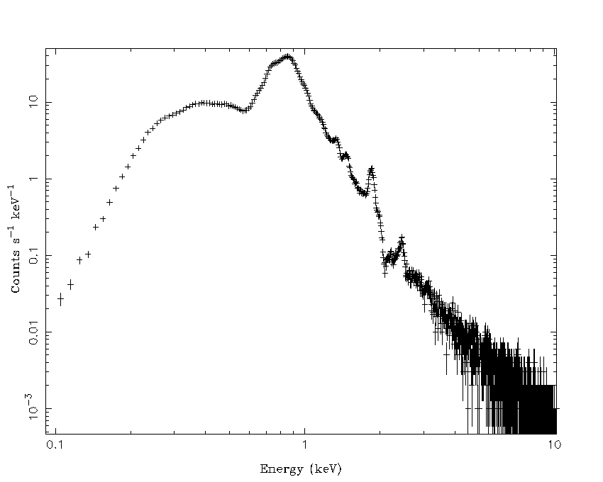

# NGC 4636 Elliptical Galaxy Example

This example follows the uses the XSPEC fakeit tool.

### XSPEC

```bash

XSPEC version: 12.14.0h


XSPEC12> @ngc4636_specmodel.xcm

XSPEC12> fakeit none

For fake spectrum #1 response file is needed: axis_ccd_20221101.rmf

   ...and ancillary file: axis_onaxis_20230701.arf

 Use counting statistics in creating fake data? (y):

 Input optional fake file prefix:

 Fake data file name (): ngc4636_globalspec_100ks.fak

 Exposure time, correction norm, bkg exposure time (1.00000, 1.00000, 1.00000): 100000.0,,

```


